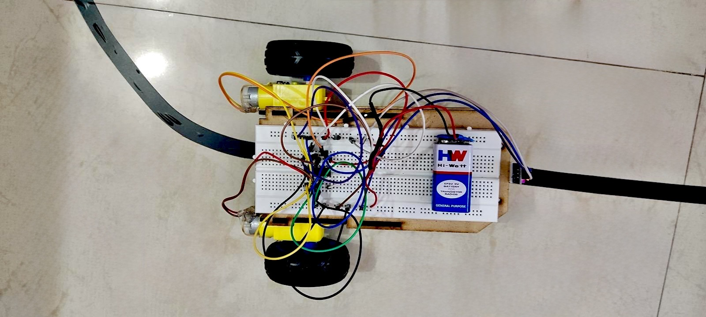

# Line Following Robot - Without Arduino

An autonomous line-following robot built using IR sensors, DC geared motors and discrete electronic control circuitry — without an Arduino or programmable microcontroller.

This project was built as a hands-on exploration of electronics, robotics, sensor-based control and hardware prototyping.

---

## 📌 Overview

A line-following robot is an autonomous system that detects a predefined path and continuously adjusts its movement to remain on the track.

In this project, IR sensors are used to detect a black line against a contrasting surface. The sensor outputs are processed through a hardware-based control circuit, which controls the two DC geared motors and allows the robot to adjust its direction.

The project focuses on understanding the electronics behind autonomous movement rather than relying on a programmable controller.

---

## ✨ Features

- Autonomous line detection
- IR-based sensing
- Dual DC geared motors
- Differential drive
- Hardware-based control logic
- Battery-powered operation
- Breadboard-based circuit implementation
- Built without Arduino or a programmable microcontroller

---

## 🧩 Components Used

| Component | Purpose |
|---|---|
| IR Sensors | Detect the line |
| DC Geared Motors | Drive the robot |
| Wheels | Provide movement |
| Transistors / Switching Components | Control motor operation |
| Resistors | Circuit control |
| Breadboard | Circuit prototyping |
| Jumper Wires | Electrical connections |
| Battery | Power supply |
| Robot Chassis | Mechanical support |

> The exact component values and circuit configuration depend on the hardware implementation used in the prototype.

---

## ⚙️ How It Works

The robot uses IR sensors to detect the position of the black line relative to the robot.

Based on the sensor outputs, the control circuit determines how the left and right motors should operate. By changing the movement of the two motors independently, the robot can correct its direction and follow the track.

### Basic Control Logic

| Left Sensor | Right Sensor | Movement |
|---|---|---|
| White | White | Move forward |
| Black | White | Turn left |
| White | Black | Turn right |
| Black | Black | Stop / adjust |

> The exact response can vary depending on the sensor configuration and circuit implementation.

---

## 🔌 System Flow

```text
              IR Sensors
                   │
                   ▼
            Line Detection
                   │
                   ▼
          Hardware Control
              Circuit
             │       │
             ▼       ▼
        Left Motor  Right Motor
             │       │
             └───┬───┘
                 ▼
          Robot Movement

```

## 🛠️ Hardware Implementation
The complete prototype was assembled using a breadboard-based circuit mounted on a simple robot chassis.
The robot consists of:
- Two DC geared motors
- Two wheels
- IR sensing circuitry
- Discrete electronic control circuitry
- Battery-powered supply
- Breadboard-based connections
- Robot chassis
The prototype was tested on a black-line track to observe sensor detection, motor response and directional correction.

---

## 🚫 Why Without Arduino?
The main objective was to understand how a simple autonomous system can be implemented at the hardware level.
By building the robot without an Arduino or programmable microcontroller, the project provided practical exposure to:
- Sensor interfacing
- Electronic switching
- Motor control
- Hardware-based logic
- Power distribution
- Breadboard prototyping
- Hardware debugging
- Sensor-to-actuator interaction
This approach also provides a foundation for understanding how similar robotic systems can later be implemented using microcontrollers and embedded programming.

---

## 🧠 Concepts Explored
- IR sensing
- Sensor-based control
- Transistor switching
- DC motor control
- Differential drive
- Basic control logic
- Circuit prototyping
- Power supply connections
- Hardware debugging
- Sensor-to-actuator interfacing

---

## 🧪 Testing
The robot was tested on a black electrical-tape track placed on a contrasting surface.
Testing focused on:
- Detecting the line
- Forward movement
- Left and right correction
- Motor response
- Maintaining the robot's position on the track

---

## 📸 Prototype



---

## 🎥 Demonstration

A demonstration of the physical prototype following the track is included below.

[▶️ Watch the Robot Demonstration](https://github.com/RSahanaa/Line-Following-Robot/blob/main/demo.mp4)

---

## 🚀 Future Improvements
Possible improvements for future versions include:
- Improved sensor positioning
- Adjustable sensor sensitivity
- Cleaner motor driver circuitry
- Multiple IR sensors for smoother tracking
- Custom PCB implementation
- Improved chassis design
- Rechargeable battery system
- Microcontroller-based control
- PID-based line-following
- Smoother and higher-speed track correction

---

## 🎯 Project Objective
The objective of this project was to build a simple autonomous robotic system while gaining practical experience with electronics, sensing and motor control.
Rather than beginning with a programmable controller, the project focuses on understanding the hardware-level concepts that form the foundation of autonomous robotic systems.

---

## 👩‍💻 Author

**R. Sahanaa**<br>
B.Tech Electronics & Communication Engineering<br>
PES University, Bengaluru<br><br>
Exploring electronics, software, robotics and practical technology projects.

---

## 📌 Project Category
Electronics · Robotics · Hardware Prototyping · Embedded Systems
